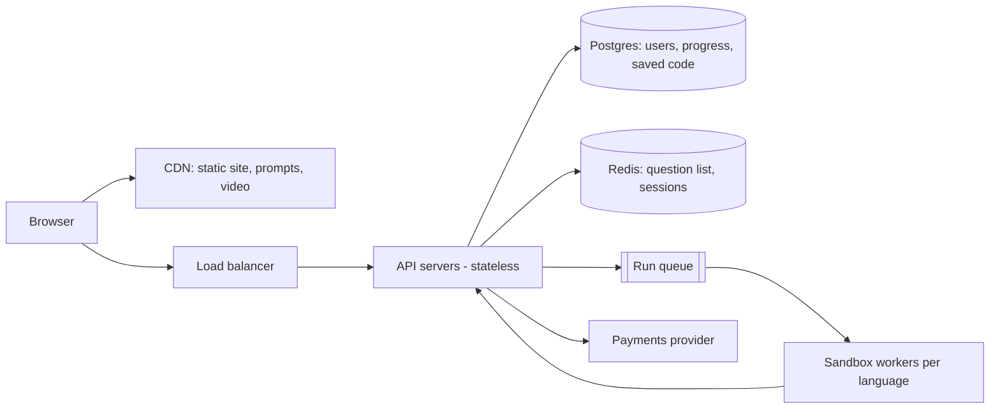

# Design AlgoExpert (coding-interview prep platform)

> Original study notes for the SystemsExpert-style prompt. Use them to practise, then run the interview from scratch.

## 1. Clarifying questions
- Which parts are in scope: browsing questions, the code editor, running code, user progress, payments?
- How many languages must code execution support?
- Global audience or one region? Latency targets for 'Run Code'?
- Is static content (prompts, video) mostly read-only and edited by a small team?

## 2. Requirements
**Functional**
- List questions with per-user completion status
- View a question (prompt, hints, video walkthrough)
- Write code in the browser, autosave it per language
- Run code against test cases and see results
- Track progress across devices

**Non-functional**
- ~99.9% availability for browsing; code execution can degrade gracefully
- Run-code p95 under ~3 s
- No loss of saved user code
- Strong isolation of untrusted code

## 3. Capacity estimates
- ~1M users, ~10k concurrent at peak; ~200 questions
- Static content ~ few hundred MB excl. video -> CDN
- Autosave every few seconds while typing: ~10k writes/s peak -> debounce client-side to ~1/10s -> ~1k writes/s
- Code runs: ~1-2k/min peak; each needs ~1-2 s of sandbox CPU -> ~50 concurrent sandboxes, provision headroom x3

## 4. High-level architecture


## 5. Data model
- questions(id, name, difficulty, category, prompt_md, tests_json, version)
- users(id, email, plan, created_at)
- user_code(user_id, question_id, language, code, updated_at) PK(user_id, question_id, language)
- completions(user_id, question_id, completed_at)

## 6. API
```
GET  /questions                          -> [{id, name, difficulty, category, completed}]
GET  /questions/{id}                     -> prompt, hints, starter code
PUT  /questions/{id}/code/{language}     body {code}
POST /questions/{id}/run                 body {language, code} -> {runId}
GET  /runs/{runId}                       -> {status, results[]}
```

## 7. Deep dives
### Code execution
Untrusted code runs in per-language container pools (gVisor/Firecracker style isolation), no network, CPU/memory/time limits. Keep warm containers to avoid cold starts; route by language via the queue. Results are pushed back (websocket) or polled.

### Autosave
Client debounces and sends deltas; server does last-write-wins keyed by (user, question, language) with updated_at. Local storage keeps a copy for offline edits.

### Global latency
Static assets on a CDN; API in 2-3 regions with a primary DB and read replicas; sandbox fleets in each region so run latency stays low.

## 8. Trade-offs & alternatives
- Polling vs websockets for run results: polling is simpler and fine at this scale
- Single relational DB is enough at this size; shard by user_id later if needed
- Pre-warmed sandboxes cost money but are what keeps p95 low
