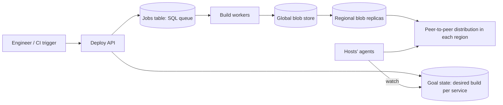

# Design a Code-Deployment System

> Original study notes for the SystemsExpert-style prompt. Use them to practise, then run the interview from scratch.

## 1. Clarifying questions
- Build + deploy, or deploy only?
- How many machines/regions; how big are binaries?
- How fast must a deploy reach every machine?
- Do we need rollbacks and canary/gradual rollouts?

## 2. Requirements
**Functional**
- Trigger a build for a commit SHA
- Store build artifacts
- Deploy a chosen build to all hosts (global) with progress
- Roll back to a previous build

**Non-functional**
- Builds take minutes but must never be lost or run twice
- Deploy to hundreds of thousands of hosts in < ~30 min
- Highly available control plane

## 3. Capacity estimates
- ~thousands of builds/day; artifacts up to ~10 GB
- ~100k-1M hosts across ~10 regions
- Fan-out: 10 GB x 1M hosts is impossible from one store -> regional replication + peer-to-peer distribution

## 4. High-level architecture


## 5. Data model
- jobs(id, sha, status{QUEUED,RUNNING,SUCCEEDED,FAILED}, worker_id, heartbeat_at, created_at)
- builds(sha, artifact_url, size, checksum, regions_replicated[])
- deployments(id, service, sha, strategy, status, started_at)
- goal_state key/value: service -> sha (strongly consistent store, e.g. etcd/ZooKeeper)

## 6. API
```
POST /builds          {sha}                -> {jobId}
GET  /builds/{sha}                         -> status, artifact
POST /deployments     {service, sha, strategy: canary|all}
GET  /deployments/{id}                     -> per-region progress
POST /deployments/{id}/rollback
```

## 7. Deep dives
### Queue as a SQL table
Workers dequeue with `UPDATE ... SET status='RUNNING', worker_id=? WHERE id=(SELECT ... FOR UPDATE SKIP LOCKED)`. ACID guarantees each job runs once. Workers heartbeat; a reaper resets stale RUNNING jobs.

### Artifact distribution
Build writes to a global store, async replicated to regional stores; deploy only proceeds once all target regions have the artifact. Within a region hosts fetch pieces from each other (BitTorrent-like) to avoid hot-spotting.

### Goal state
Deploy just flips the desired sha in a consistent KV store; host agents watch it, download, swap, and report health. Rollback = set goal to previous sha.

## 8. Trade-offs & alternatives
- SQL queue vs Kafka: SQL gives exactly-once claim semantics with modest throughput, which is enough
- P2P adds complexity but removes a bandwidth bottleneck
- Canary stages slow deploys down but limit blast radius
