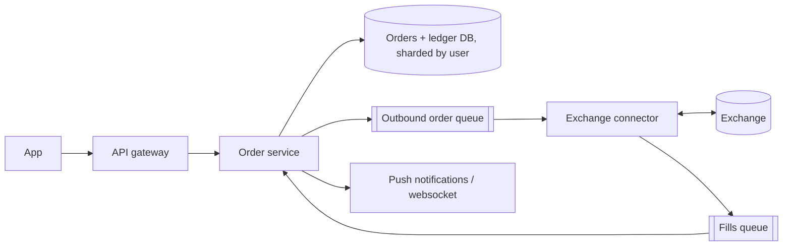

# Design a Stockbroker (e.g. Robinhood)

> Original study notes for the SystemsExpert-style prompt. Use them to practise, then run the interview from scratch.

## 1. Clarifying questions
- Do we run the exchange or route orders to one?
- Order types (market, limit), and is trading only during market hours?
- How many users and orders per day?
- Need real-time price feeds in the app?

## 2. Requirements
**Functional**
- Place, cancel and view orders
- See balances and positions
- Order status updates when filled

**Non-functional**
- Never lose or duplicate an order; balances must be correct
- Low latency to the exchange
- Highly available during market hours

## 3. Capacity estimates
- ~10M users, ~20M orders/day, peaks at open/close ~2k orders/s
- Each order ~1 KB -> tiny storage; correctness dominates design

## 4. High-level architecture


## 5. Data model
- orders(id, user_id, idempotency_key, symbol, side, type, qty, limit_price, status, exchange_order_id)
- ledger_entries(id, user_id, amount, currency, reason, order_id) - append-only, balance = sum
- positions(user_id, symbol, qty) derived from fills

## 6. API
```
POST   /orders  {idempotencyKey, symbol, side, qty, type, limitPrice?} -> order
DELETE /orders/{id}
GET    /orders?status=open
GET    /portfolio -> balances, positions
```

## 7. Deep dives
### Exactly-once order placement
Client sends an idempotency key; order row is written (status PENDING) in the same transaction that reserves buying power. A connector picks PENDING orders, sends them with our client order id so retries are deduplicated by the exchange.

### Fills
The exchange streams executions; connector writes them to a durable queue; order service applies them idempotently (keyed by execution id) updating order status, ledger and positions in one transaction.

### Scaling
Shard by user_id; exchange connectors partitioned by symbol range; keep hot reads (portfolio) in a cache invalidated by fills.

## 8. Trade-offs & alternatives
- Strong consistency on money paths over availability
- Queue between us and the exchange decouples bursts but adds latency (ms)
- Ledger vs mutable balance: ledger is auditable; cache the sum
