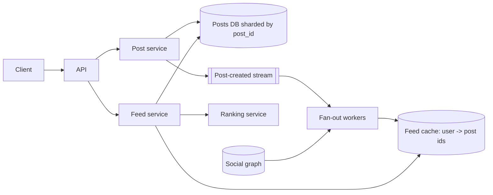

# Design Facebook News Feed

> Original study notes for the SystemsExpert-style prompt. Use them to practise, then run the interview from scratch.

## 1. Clarifying questions
- Ranked or chronological?
- Text only or media too?
- Friends only, or pages/groups?
- How fresh must the feed be?

## 2. Requirements
**Functional**
- Create posts
- See a feed of friends' posts
- Like/comment counts on posts

**Non-functional**
- Feed load p95 < 500 ms
- Eventual consistency acceptable (seconds)
- Billions of users, highly available

## 3. Capacity estimates
- ~2B users, ~1B DAU, each opens feed ~10x/day -> ~100k feed reads/s avg, ~300k peak
- ~500M posts/day -> ~6k writes/s
- Average ~500 friends; celebrities millions of followers

## 4. High-level architecture


## 5. Data model
- posts(id, author_id, body, media_urls, created_at)
- edges(user_id, friend_id)
- feed_cache: user_id -> list of (post_id, score) capped ~500

## 6. API
```
POST /posts {body, media}
GET  /feed?cursor=...&limit=20 -> posts[], nextCursor
```

## 7. Deep dives
### Fan-out on write vs read
Push post ids into followers' precomputed feeds for normal users (fast reads). For celebrities (> ~10k followers) skip fan-out and merge their recent posts at read time - hybrid model.

### Ranking
Feed service fetches candidate ids, hydrates posts in batch, scores with a model (affinity, recency, engagement) and paginates with a stable cursor.

### Storage
Posts in a sharded KV/SQL store; media in blob store + CDN; feed cache in Redis/Memcache clusters sharded by user_id, rebuildable from source.

## 8. Trade-offs & alternatives
- Precomputed feeds use a lot of memory but give low latency
- Hybrid fan-out adds read-time merge complexity
- Eventual consistency means your own post may appear slightly late - write-through to your own feed fixes it
