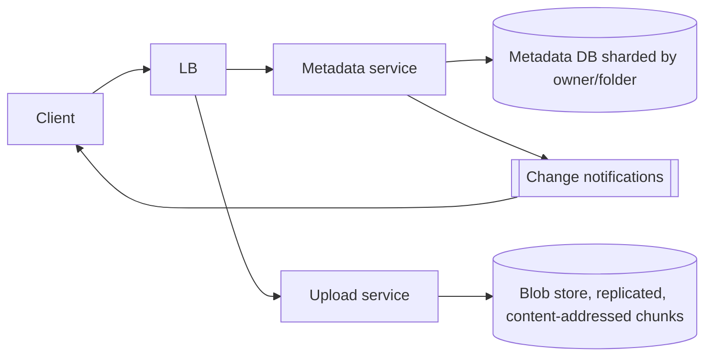

# Design Google Drive

> Original study notes for the SystemsExpert-style prompt. Use them to practise, then run the interview from scratch.

## 1. Clarifying questions
- Only file storage, or also live collaborative editing?
- Max file size? Versioning?
- Sharing permissions required?

## 2. Requirements
**Functional**
- Upload, download, delete files and folders
- Move/rename; list a folder
- Share with read/write permissions
- Sync across devices

**Non-functional**
- Durability (never lose a file), high availability
- Large files resumable
- Consistent metadata (no ghost files)

## 3. Capacity estimates
- ~1B users x ~15 GB avg used ~ exabytes of blobs
- Metadata: ~100 files/user -> 100B rows; must be sharded
- Uploads chunked (e.g. 4-8 MB) for resumability and dedup

## 4. High-level architecture


## 5. Data model
- files(id, owner_id, parent_id, name, is_folder, size, version, chunk_ids[], deleted)
- acl(file_id, principal_id, role)
- chunks(hash, size, ref_count, locations)

## 6. API
```
POST /files/upload-session {parentId, name, size} -> {sessionId}
PUT  /upload/{sessionId}/chunks/{n}
POST /upload/{sessionId}/commit -> file
GET  /files/{id}/content
GET  /folders/{id}/children
PATCH /files/{id} {name?, parentId?}
POST /files/{id}/share {principal, role}
```

## 7. Deep dives
### Upload path
Chunks are hashed client-side; the server skips chunks it already has (dedup). File metadata is committed only after all chunks are durable, so readers never see partial files.

### Metadata consistency
Folder moves must be atomic: keep a user's tree on one shard (shard by owner) so moves are single-shard transactions.

### Sync
Clients long-poll/websocket for change events with a per-user change log cursor; conflicts produce 'conflicted copy' files.

## 8. Trade-offs & alternatives
- Content-addressed chunks save space but complicate deletion (ref counts + GC)
- Sharding by owner makes shared-folder queries cross-shard
- Erasure coding cheaper than 3x replication for cold data
