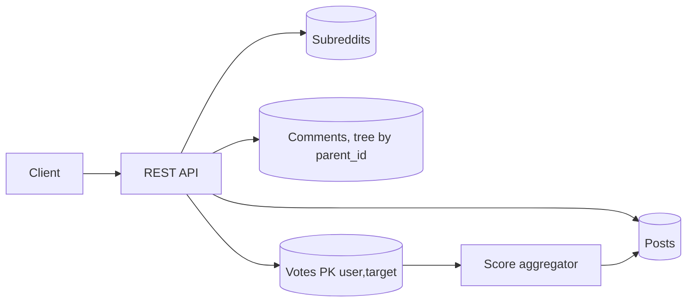

# Design the Reddit API

> Original study notes for the SystemsExpert-style prompt. Use them to practise, then run the interview from scratch.

## 1. Clarifying questions
- Which entities: subreddits, posts, comments, votes, awards?
- Is this about API shape more than infrastructure?
- Pagination and sorting requirements?

## 2. Requirements
**Functional**
- Subreddits: create, get, list posts
- Posts: create, edit, delete, vote
- Comments: threaded create/edit/delete/vote
- Sorting: hot, new, top

**Non-functional**
- Consistent, versioned, paginated REST resources
- Idempotent votes

## 3. Capacity estimates
- Read-heavy (~100:1); vote writes are the hottest write path

## 4. High-level architecture


## 5. Data model
- subreddit(id, name, description, created_by)
- post(id, subreddit_id, author_id, title, body, score, comment_count, created_at, edited_at, deleted_at)
- comment(id, post_id, parent_id, author_id, body, score, ...)
- vote(user_id, target_id, target_type, value in {-1,0,1})

## 6. API
```
GET    /v1/subreddits/{name}
GET    /v1/subreddits/{name}/posts?sort=hot|new|top&cursor=..&limit=..
POST   /v1/subreddits/{name}/posts            {title, body}
PATCH  /v1/posts/{postId}                     {body}
DELETE /v1/posts/{postId}
GET    /v1/posts/{postId}/comments?sort=..&depth=..&cursor=..
POST   /v1/posts/{postId}/comments            {parentId?, body}
PUT    /v1/posts/{postId}/vote                {value: -1|0|1}
PUT    /v1/comments/{commentId}/vote          {value}
```

## 7. Deep dives
### Votes
PUT with an absolute value makes votes idempotent; the aggregator applies (new - old) deltas to cached scores asynchronously.

### Comment trees
Fetch top-N roots by score then children to a limited depth; 'load more' via cursor on parent_id.

### Pagination
Opaque cursors (score, id) rather than offsets so lists stay stable while new content arrives.

## 8. Trade-offs & alternatives
- Soft deletes keep threads intact ('[deleted]')
- Denormalised counts are eventually consistent
- PUT for votes vs POST upvote/downvote endpoints: PUT is simpler to make idempotent
