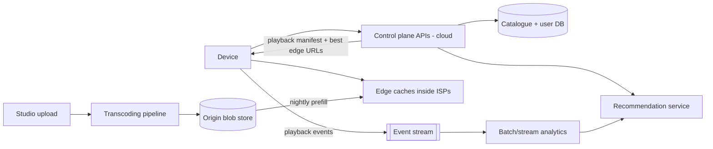

# Design Netflix

> Original study notes for the SystemsExpert-style prompt. Use them to practise, then run the interview from scratch.

## 1. Clarifying questions
- Focus on streaming/video delivery, recommendations, or both?
- How many titles and subscribers?
- Need to support many device types and bitrates?

## 2. Requirements
**Functional**
- Browse catalogue, personalised home page
- Stream a title with adaptive bitrate
- Resume playback across devices

**Non-functional**
- Very high availability, global low latency
- Startup < 2 s, minimal rebuffering

## 3. Capacity estimates
- ~200M subscribers, ~10k titles; each title encoded in ~dozens of bitrate/resolution variants -> PB scale
- Peak egress tens of Tbps -> must be served from edge caches (Open Connect style) close to ISPs

## 4. High-level architecture


## 5. Data model
- titles(id, metadata, encodes[])
- viewing_history(user_id, title_id, position, updated_at) - write-heavy, wide-column store
- manifest: per title, list of segment URLs per bitrate

## 6. API
```
GET  /home                       -> personalised rows
GET  /titles/{id}
POST /playback/{titleId}/start   -> manifest + edge URLs + DRM license info
POST /playback/{titleId}/heartbeat {position}
```

## 7. Deep dives
### Encoding
Split source into chunks, transcode in parallel into many codecs/bitrates; segment into ~2-4 s pieces for ABR (DASH/HLS).

### Delivery
Popular content is pre-positioned at edges during off-peak; clients measure throughput and switch bitrate per segment.

### Recommendations
Offline batch training on viewing logs produces candidate lists; online service re-ranks per request.

## 8. Trade-offs & alternatives
- Own CDN gives control and cost savings but large capex
- Pre-positioning wastes some storage on titles that won't be watched
- Resume position is eventually consistent (heartbeat every ~10-30 s)
