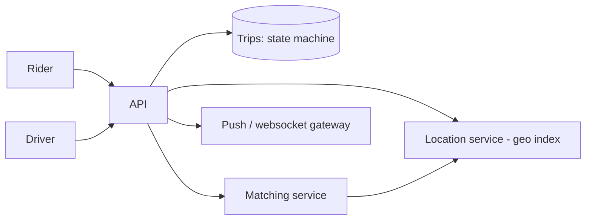

# Design the Uber API

> Original study notes for the SystemsExpert-style prompt. Use them to practise, then run the interview from scratch.

## 1. Clarifying questions
- Rider and driver APIs both?
- Payments in scope?
- Real-time location updates required?

## 2. Requirements
**Functional**
- Rider: request ride, see ETA/driver location, cancel, rate
- Driver: go online/offline, accept ride, update location, complete trip

**Non-functional**
- Real-time updates (~seconds)
- Idempotent state transitions

## 3. Capacity estimates
- Drivers send location every ~4 s; ~1M active drivers -> ~250k writes/s to the location service

## 4. High-level architecture


## 5. Data model
- Trip{tripId, riderId, driverId?, status: REQUESTED|ACCEPTED|ARRIVED|IN_PROGRESS|COMPLETED|CANCELLED, pickup, dropoff, fare}
- DriverStatus{driverId, online, location, tripId?}

## 6. API
```
POST   /trips                       {pickup, dropoff, idempotencyKey} -> Trip
GET    /trips/{tripId}              -> Trip incl. driver location, ETA
POST   /trips/{tripId}/cancel
POST   /trips/{tripId}/rating       {stars}
PUT    /drivers/me/status           {online: true|false}
PUT    /drivers/me/location         {lat, lng}
POST   /trips/{tripId}/accept
POST   /trips/{tripId}/arrive | /start | /complete
Stream: GET /stream (websocket) -> trip updates, offers to drivers
```

## 7. Deep dives
### State machine
Every transition is validated server-side (e.g. accept only from REQUESTED) with optimistic concurrency, so double taps or two drivers accepting resolve deterministically.

### Location
Updates go to an in-memory geo index (geohash/S2 cells) sharded by region; matching queries nearby cells.

### Push vs poll
Websocket for live location; polling fallback.

## 8. Trade-offs & alternatives
- Separate endpoints per transition are explicit and auditable vs a generic PATCH status
- In-memory geo index trades durability for speed (locations are ephemeral anyway)
