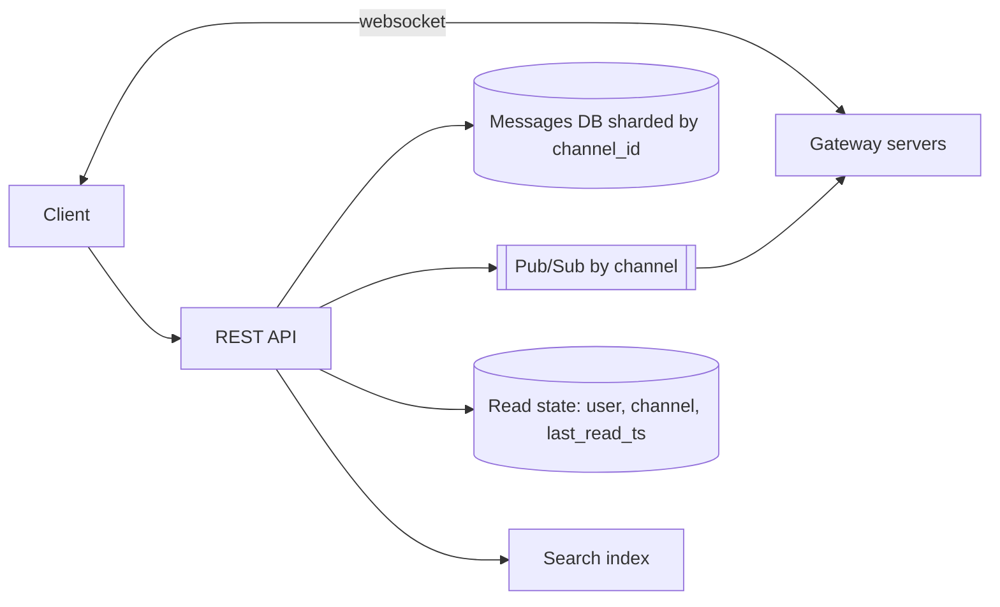

# Design Slack

> Original study notes for the SystemsExpert-style prompt. Use them to practise, then run the interview from scratch.

## 1. Clarifying questions
- Channels and DMs? Threads, reactions, file uploads?
- Max workspace size?
- Must messages sync across devices with unread counts?

## 2. Requirements
**Functional**
- Send/receive messages in channels and DMs in real time
- Load message history with pagination
- Unread indicators and mentions
- Workspaces/organisations

**Non-functional**
- Messages delivered in < ~500 ms
- No message loss; ordering per channel
- Large orgs (100k members) supported

## 3. Capacity estimates
- ~10M DAU, ~100 messages/user/day -> ~1B messages/day ~ 12k/s avg
- Messages ~1 KB -> ~1 TB/day

## 4. High-level architecture


## 5. Data model
- channels(id, workspace_id, name, type)
- memberships(channel_id, user_id)
- messages(channel_id, ts, author_id, body, thread_ts) PK(channel_id, ts)
- read_state(user_id, channel_id, last_read_ts)

## 6. API
```
POST /channels/{id}/messages {text, clientMsgId}
GET  /channels/{id}/messages?before=ts&limit=50
POST /channels/{id}/read {ts}
WS   events: message.new, message.edited, reaction.added, typing
```

## 7. Deep dives
### Real-time fan-out
Gateways subscribe to channels their connected users belong to; a message is persisted first, then published; gateways push to sockets. Very large channels fan out through hierarchical pub/sub.

### Ordering
Server-assigned ts per channel (monotonic per shard); client dedupes with clientMsgId.

### Unreads
Compare channel latest ts with read_state; computed on connect and kept live by events.

## 8. Trade-offs & alternatives
- Sharding by channel keeps history queries local; huge workspaces need channel-level partitioning
- Persist-then-publish adds a few ms but guarantees no lost messages
