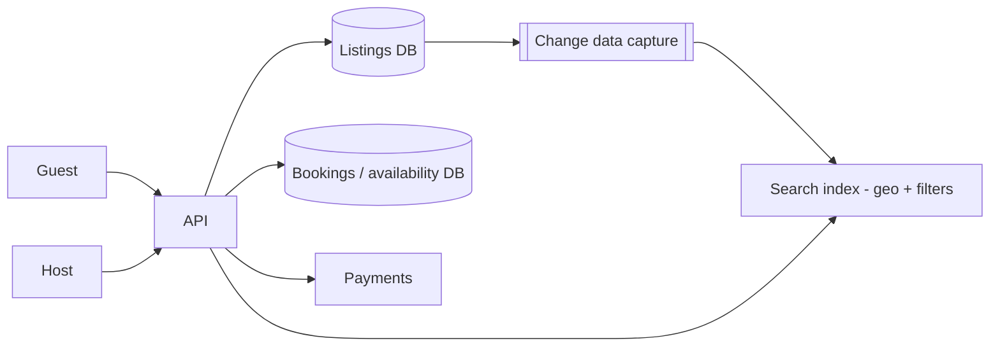

# Design Airbnb

> Original study notes for the SystemsExpert-style prompt. Use them to practise, then run the interview from scratch.

## 1. Clarifying questions
- Search + booking + host listing management in scope? Payments?
- Can two guests book overlapping dates? (No)
- Scale of listings?

## 2. Requirements
**Functional**
- Hosts create listings with availability
- Guests search by location/dates/price
- Guests book; double booking impossible

**Non-functional**
- Search fast (< 300 ms)
- Booking strongly consistent

## 3. Capacity estimates
- ~10M listings, ~100M searches/day (~1.2k/s), ~1M bookings/day

## 4. High-level architecture


## 5. Data model
- listings(id, host_id, geo, price, attributes)
- availability(listing_id, date, status) PK(listing_id, date)
- bookings(id, listing_id, guest_id, start, end, status)

## 6. API
```
GET  /search?lat&lng&radius&checkIn&checkOut&guests&priceMax
GET  /listings/{id}
POST /listings  (host)
POST /bookings {listingId, checkIn, checkOut, idempotencyKey}
```

## 7. Deep dives
### No double booking
In one transaction, lock the availability rows for the date range (SELECT ... FOR UPDATE) and mark them reserved; or insert into a table with a unique (listing_id, date) constraint. Temporary holds expire if payment fails.

### Search
Geo index (geohash/quadtree) in Elasticsearch with date availability filters; results may be slightly stale, so booking re-validates.

### Payments
Authorise at booking, capture after check-in.

## 8. Trade-offs & alternatives
- Search eventual consistency vs booking strong consistency
- Per-date rows are simple; range types/interval trees are more compact
