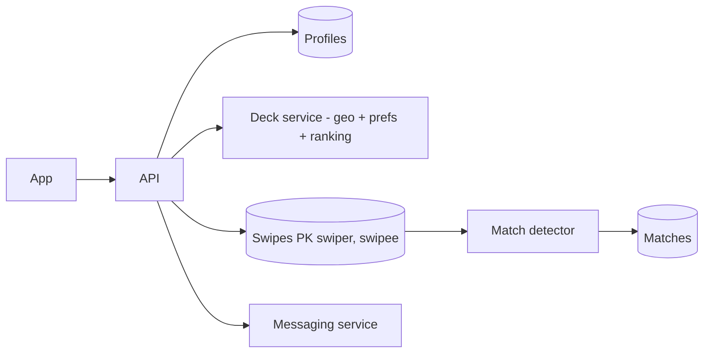

# Design Tinder

> Original study notes for the SystemsExpert-style prompt. Use them to practise, then run the interview from scratch.

## 1. Clarifying questions
- Profiles, swiping, matches, chat - which are in scope?
- How are recommendations generated?

## 2. Requirements
**Functional**
- Create/update profile and preferences
- Get a deck of candidate profiles
- Swipe left/right; mutual right swipe creates a match
- List matches; message matches

**Non-functional**
- Deck loads quickly; swipes never lost
- Match created exactly once

## 3. Capacity estimates
- ~50M DAU x ~100 swipes/day ~ 60k swipes/s peak

## 4. High-level architecture


## 5. Data model
- profile(user_id, name, photos, bio, geo, prefs)
- swipe(swiper_id, swipee_id, decision, ts)
- match(id, user_a, user_b, created_at) unique(min,max)

## 6. API
```
GET  /v1/profile, PUT /v1/profile
GET  /v1/deck?limit=50            -> profiles[]
POST /v1/swipes {profileId, decision: LIKE|PASS} -> {matched: bool, matchId?}
GET  /v1/matches?cursor
POST /v1/matches/{id}/messages {text}
GET  /v1/matches/{id}/messages?cursor
```

## 7. Deep dives
### Match detection
On LIKE, check whether the reverse LIKE exists; insert the match with a unique constraint on the ordered pair so concurrent likes create one match.

### Deck
Precompute decks in the background per user; exclude already-swiped profiles with a bloom filter.

## 8. Trade-offs & alternatives
- Synchronous match check gives instant 'It's a match!' at slightly higher write latency
- Precomputed decks may be slightly stale
