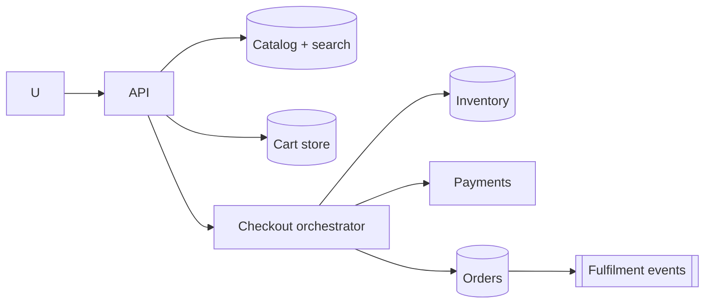

# Design Amazon (cart, checkout and inventory)

> Original study notes for the SystemsExpert-style prompt. Use them to practise, then run the interview from scratch.

## 1. Clarifying questions
- Catalog browsing, cart, checkout, inventory, orders?
- Flash sales / hot items?

## 2. Requirements
**Functional**
- Browse/search products
- Cart management
- Checkout with payment and inventory reservation
- Order history

**Non-functional**
- Never oversell; never double charge
- Browsing highly available

## 3. Capacity estimates
- ~100M DAU, ~10M orders/day (~120/s avg, 10x at peaks)

## 4. High-level architecture


## 5. Data model
- inventory(sku, warehouse, available, reserved)
- orders(id, user_id, items, status, payment_id, idempotency_key)

## 6. API
```
POST /cart/items {sku, qty}
POST /checkout {cartId, addressId, paymentMethodId, idempotencyKey} -> order
GET  /orders/{id}
```

## 7. Deep dives
### Saga
Reserve inventory -> authorise payment -> create order -> capture; on failure run compensations (release reservation, void auth).

### Hot items
Shard inventory counters; for flash sales use a token queue to admit buyers.

## 8. Trade-offs & alternatives
- Saga vs 2PC: saga is available and scalable at the cost of temporary inconsistency
- Reservations with TTL avoid inventory lockup
