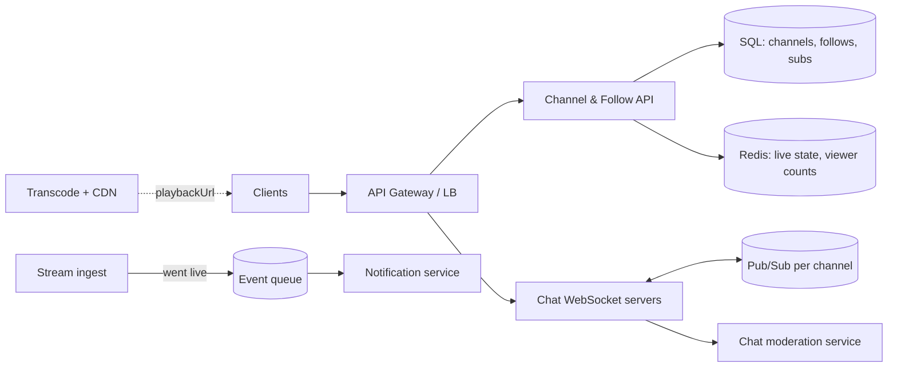

# Design the Twitch API

> Original study notes for the SystemsExpert prompt. Use them to practise, then run the interview from scratch.
> Scope like the course prompt: the **API layer** behind the Twitch player page (stream, chat, follows, subscriptions), not video encoding internals.

## 1. Clarifying questions
- Which parts of the page are in scope: video player, chat, viewer count, follow/subscribe buttons?
- Logged-in and anonymous viewers?
- Are there chat moderation features (bans, slow mode, emote-only)?
- Does the API serve the video itself, or only metadata plus a playback URL?

## 2. Requirements
**Functional**
- Get stream info for a channel: title, game, live/offline, viewer count, playback URL
- Real-time chat: send and receive messages, with moderation
- Follow and unfollow a channel; subscribe (paid tiers)
- Notify followers when a channel goes live

**Non-functional**
- Chat fan-out to 100k+ viewers in one channel, delivered in under a second
- Viewer counts can be approximate and a few seconds stale
- Subscriptions and payments must be strongly consistent and idempotent

## 3. Entities
```
Channel   { id, ownerUserId, title, gameId, isLive, streamStartedAt }
User      { id, username, ... }
Follow    { userId, channelId, createdAt }
Subscription { id, userId, channelId, tier, status, renewsAt }
ChatMessage  { id, channelId, userId, text, createdAt }
Ban       { channelId, userId, expiresAt? }
```

## 4. API
```
GET    /channels/{channelId}               -> Channel + viewerCount + playbackUrl (signed, short-lived)
GET    /channels/{channelId}/viewers/count
POST   /channels/{channelId}/follow        (idempotent)
DELETE /channels/{channelId}/follow
POST   /channels/{channelId}/subscriptions { tier, paymentToken, idempotencyKey }
DELETE /subscriptions/{subscriptionId}

# Chat: long-lived connection
WS     /channels/{channelId}/chat
  client -> { type: "send", text, clientMessageId }
  server -> { type: "message", ChatMessage } | { type: "moderation", action, userId }
POST   /channels/{channelId}/bans { userId, durationSec? }   (moderators only)
POST   /channels/{channelId}/chat-settings { slowModeSec, emoteOnly, followersOnly }
```
Pagination with cursors on list endpoints. Auth with OAuth bearer tokens, scoped per action.

## 5. Architecture


## 6. Deep dives
- **Chat fan-out:** clients hash to WebSocket servers; each server subscribes to the channel topic it has viewers for. A message is published once and each server pushes to its local sockets. For huge channels, batch messages every ~100 ms and sample or rate-limit sending.
- **Moderation:** check bans and slow mode before publishing (cache them in Redis). Deletions are published as moderation events so clients remove messages.
- **Viewer count:** each WS/edge server reports per-channel counts every few seconds; an aggregator sums them into Redis. Show approximate values.
- **Go-live notifications:** an ingest event goes onto a queue; workers page through followers and send push/email in batches. Large channels take minutes, which is acceptable.
- **Subscriptions:** require an idempotency key, call the payment provider, write the subscription in a transaction, then emit an event (badge in chat, emote unlock).
- **Video:** the API returns only a signed CDN playlist URL (HLS); the video bytes never go through this API.

## 7. Trade-offs
- WebSockets versus long polling for chat: WS gives lower latency and less overhead.
- Chat is persisted asynchronously (log/queue → storage). The live path doesn't wait on the database.
- Viewer counts are eventually consistent; payments are strongly consistent.
